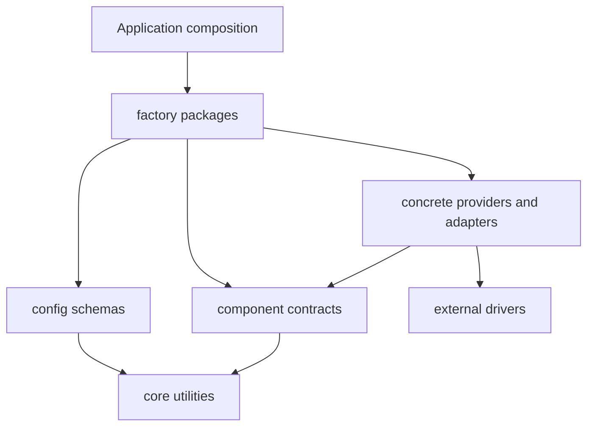

# Architecture

go-atlas is a toolkit composed of Go packages in one root module. Applications own construction, startup and shutdown; individual packages can be used
without a framework bootstrap. The integration suite and development tools are separate modules under `tests/integration` and `devtools`.

Several adjacent capabilities have already been extracted into their own modules, including `go-atlas-core`, `go-atlas-net`, `go-nomos`, `go-horai`,
`go-kryptos`, `go-slogx`, `go-tlsutils` and `go-aip`. This document describes the packages that remain in the go-atlas root module and their dependency
boundaries. `tests/architecture/modules_test.go` also encodes the finer-grained module boundaries used by the modularization plan; those are target
boundaries, not the current physical module layout.

## Dependency boundaries

Dependencies are governed at the Go package level. Top-level directories describe capabilities, not strictly ordered layers: factories and concrete
adapters intentionally connect capabilities. Go rejects actual import cycles; a cycle in an aggregated directory diagram is not an import cycle.

| Package role                                                   | Allowed dependencies and responsibility                                                                                                                                                                                                                                                                                                                                                                                                                                                                                                                                                                                      |
| -------------------------------------------------------------- | ---------------------------------------------------------------------------------------------------------------------------------------------------------------------------------------------------------------------------------------------------------------------------------------------------------------------------------------------------------------------------------------------------------------------------------------------------------------------------------------------------------------------------------------------------------------------------------------------------------------------------- |
| `go-atlas-core`, `go-atlas-net`, `go-nomos`, `go-horai`        | External modules, like `go-kryptos`, `go-slogx`, `go-tlsutils` and `go-aip`: each repository owns its own boundaries and is imported here as an ordinary dependency. The former `core/*`, `net/*` (HTTP client and gRPC primitives included), `config/loader` and `service/scheduler` trees live there; their config-driven builders stay here under `factory/ext/<module>`. `tests/architecture` reads go-atlas-core as `core/*`, go-atlas-net as `net/*`, go-nomos as `config/*` and go-horai as `service/scheduler/*` in the rules below.                                                                                 |
| `config/*` schema packages                                     | Schemas, defaults and validation, one package per capability (`grpcconfig`, `redisconfig`, ...). Import only go-atlas-core, other schema packages, config internals, the go-atlas-net `egressrule` and `proxyconfig` packages, the go-horai `task` and `schedule` packages and validation libraries. No runtime clients or component constructors. The root `config` package declares no types.                                                                                                                                                                                                                                                 |
| `domain/*`                                                     | Domain helpers, go-atlas-core and observability interfaces. Backend translators remain separate subpackages. No direct transport import: `net/http`, `google.golang.org/grpc` or `transport/*`.                                                                                                                                                                                                                                                                                                                                                                                                                              |
| `store/*`                                                      | Storage clients (`store/mongo`, `store/meilisearch`, `store/postgres`); drivers allowed. Backends of `audit/*`, `coord/*` and `reliability/*` contracts build on them.                                                                                                                                                                                                                                                                                                                                                                                                                                                                         |
| `cache/*`                                                      | Caching with singleflight, generation invalidation and probabilistic filters; roots driver-free, backends in `storages/*`.                                                                                                                                                                                                                                                                                                                                                                                                                                                                                                   |
| `coord/*`                                                      | Distributed coordination: `dlock`, `leadelect`, `limiters`; roots driver-free, backends in `providers/*` and `storages/*`.                                                                                                                                                                                                                                                                                                                                                                                                                                                                                                   |
| `reliability/*`                                                | Delivery and execution guarantees: `idempotency`, `outbox`, `saga`, `retryqueue`; roots driver-free, backends in `storages/*` and `engines/*`.                                                                                                                                                                                                                                                                                                                                                                                                                                                                               |
| `mapping/*`                                                    | Structural mapping: `behavior` (+ backend `translators/*`), `fieldtracker`. Same transport ban as `domain/*`.                                                                                                                                                                                                                                                                                                                                                                                                                                                                                                                |
| `messaging/*`                                                  | Broker (`messaging/broker`, NATS JetStream provider, outbox publisher, consumer deduplication) and the in-process event bus (`messaging/eventbus`).                                                                                                                                                                                                                                                                                                                                                                                                                                                                          |
| `audit/*`                                                      | Audit events and authorization decision records (`audit/decision`); root driver-free, backends in `storages/*`.                                                                                                                                                                                                                                                                                                                                                                                                                                                                                                              |
| `observability/tracing`, `observability/metrics`               | Backend-neutral contracts and dispatch to the `adapters` interface package; no concrete adapter or transport import.                                                                                                                                                                                                                                                                                                                                                                                                                                                                                                         |
| `*/adapters/*`, `*/storages/*`, `*/providers/*`, `*/engines/*` | Concrete integration dependencies and the contracts they implement.                                                                                                                                                                                                                                                                                                                                                                                                                                                                                                                                                          |
| `factory/*`                                                    | The composition layer: `factory/<path>` builds `<path>`, a factory of an external module lives under `factory/ext/<module>` (`factory/ext/kryptos`, `factory/ext/net/httpclient`, `factory/ext/core/dispatch`, `factory/ext/aip/pagination/pagetoken`), and `factory/infrastructure/*` constructs connections to external systems. Composition from schemas and injected dependencies; may import concrete adapters, clients, providers and other factories. The only readers of schemas besides `config/*` itself. A factory of a driver backend or heavy SDK is its own package, registered on the driver-neutral factory. |
| `transport/*`, `auth/*`, `security/*`                          | Runtime capabilities assembled from interfaces, go-atlas-core helpers and required integrations. The gRPC adapter of the go-horai scheduler, `transport/grpc/handlers/scheduler`, is the only transport package that reaches go-horai beyond its `task` and `schedule` contracts.                                                                                                                                                                                                                                                                                                                                            |
| `internal/*`                                                   | Module-wide internals: `internal/{nats,redis,memcleanup,sqldialect}` hold backend bases shared by storages and their factories; `internal/transport/*` holds the transport internals. They import other internal packages and external modules only; the few that import a public package of this module are listed in `tests/architecture` (`internalCapabilityImports`).                                                                                                                                                                                                                                                   |

### AIP request contracts

The AIP request contracts live in [go-aip](https://github.com/altessa-s/go-aip): `filter` (+ `parser`, `evaluator`, `functions`), `orderby`,
`projection`, `fieldpolicy`, `listing`, `pagination/pagetoken`, `pagination/page`, `fieldmask` (+ `update`, `extract`), `fieldbehavior`, `etag` and
`decimal128`; its storage backends (filter, order and projection translators, schemas, evaluator profiles and list engines) are modules of their own
under `backend/`. go-atlas keeps only the framework wiring: `factory/ext/aip/pagination/pagetoken` builds a `pagetoken.Codec` from `config/paging`; the
gRPC `fieldmask` and `fieldbehavior` interceptors and the HTTP response sanitizer run `fieldmask/update`, `fieldmask/extract` and `fieldbehavior`;
`transport/grpc/handlers/scheduler` parses filters with an injected `filter/parser`; `audit` and `store/mongo/keyset` sign page tokens with an
injected codec; and `store/mongo/bsoncodec` bounds decimals with `decimal128`. Production code imports only the root go-aip module: an application
requires the go-aip backends it uses itself. `tests/architecture` enforces this; a go-atlas test may require a backend module (the keyset test uses
`backend/mongo`).

`reliability/idempotency/principalowner` is the adapter at the authentication/data boundary: it turns the verified tenant and subject in
`auth/principal` into a
`reliability/idempotency.OwnerFunc`. The data package accepts only that callback and imports no authentication packages.

Schemas and runtime packages alike register tasks through the go-horai `task` contract and parse cron specs with its `schedule` grammar. `cache/lru`
uses `github.com/hashicorp/golang-lru/v2`; it is an explicit package-scoped exception of a shared leaf. The egress rule grammar lives in go-atlas-net
(`egressrule`) so the `httpconfig` schema and the go-atlas-net HTTP client share it. The third-party exceptions of go-atlas-core and go-atlas-net
packages are checked in their own repositories. Database codecs of universal value types belong in `store/mongo/bsoncodec`.

Runtime and contract packages take generated options and injected dependencies: they never import schema packages or `factory/*` packages.
A component that needs an outbound client accepts it (for example `oidc.WithHTTPClient(*http.Client)`); the factory builds the resilient
client from configuration.

`make check-architecture` runs `tests/architecture` in the root module. It parses production imports on every platform and enforces the boundaries
above,
that runtime packages read no schemas and that only composition imports factories. The same check runs in CI. Test dependencies and the separate
integration module are excluded. Other composition rules require ordinary code review; the check does not claim to enforce a complete layer ordering.

## Consumer-side seams

Consumers declare the interfaces they call; `factory/` or application composition wires concrete implementations. The seams include
`DecisionRecorder`,
`HealthReporter`/`HealthWatcher`, audit `EventEmitter`, broker `Keeper`, and the local `TokenCodec` ports (implemented by `pagetoken.Codec`, alongside
`pagetoken.Signer`, both go-aip). Scheduler handlers accept `FilterParser`; transport limiters use context helpers from `coord/limiters`. Any interface
parameter must treat typed nils as nil with `go-atlas-core/types/nilcheck`.

Two of these boundaries are checked beyond direct imports. The backend-neutral contracts (`observability/tracing`, `observability/metrics`) must
not reach a storage or messaging driver through any production dependency: the check resolves
their full dependency set with `go list` for `linux`, `darwin` and `windows` and rejects the MongoDB driver, go-redis, nats.go, the ClickHouse
clients,
the SQL drivers and `store/mongo/*`. The domain transport rule stays direct-only, because domain packages may use observability interfaces whose
metrics adapter contract exposes an `http.Handler`.

## SQL backends

`audit`, `coord/dlock`, `reliability/saga`, `reliability/outbox`, `reliability/idempotency`, `reliability/retryqueue` and the go-horai scheduler each
have a `sqldb` backend beside their MongoDB (and NATS or Redis) ones. The backends take a caller-owned `*sql.DB` and a dialect — `postgres`, or `mysql`
for MySQL and MariaDB — through `internal/sqldialect`. The optional `store/postgres` package supplies a pgx pool. Backend constructors perform no I/O,
and `EnsureSchema` is a separate idempotent call. The lock, idempotency and
outbox stores evaluate time predicates against the database clock. Stores whose MongoDB counterpart relies on a TTL index purge expired rows with
`PurgeExpired`, from a background loop that starts on the first write and stops with `Close`. The outbox store implements `outbox.Watcher` with
PostgreSQL `LISTEN`/`NOTIFY` through an injected `Listener`, the SQL counterpart of the MongoDB change stream. Configuration keys and the shared rules
are in [configuration](configuration.md#sql-backends).

## Configuration and adapters

Package constructors accept required dependencies as positional arguments and generated functional options for tunables. Configuration structs are
schemas in the `config/*` packages; runtime packages do not expose another mutable public Config as an alternative to options. Factories validate
schemas and materialize options. Nil optional telemetry dependencies use no-ops; required storage, codecs and credentials remain required.

Outbound proxy mapping lives in `factory/ext/net/proxydial`: `HTTPClientOptions(cfg.Proxy)` and `GRPCClientOptions(cfg.Proxy)`. Client health and HTTP
SSRF mapping live in `factory/ext/net/httpclient` and `factory/transport/grpc/client`. See the [proxy guide](proxy.md).

BSON encoding of `optional.Optional[T]` uses `store/mongo/bsoncodec.NewRegistry()`. `store/mongo` installs this registry for clients it constructs
unless
an explicit registry overrides it. Supplied clients and standalone BSON encoders/decoders must be configured by their owners. An unconfigured codec
fails explicitly instead of silently serializing private fields. RedactedString retains a fixed BSON string redaction hook without importing the
driver,
so redaction works with the default registry too.

## Lifecycle and state ownership

Instances own their clients, queues and worker lifecycles unless a constructor explicitly accepts an externally owned dependency. Background tasks
must
expose errors at registration/startup and have a bounded stop path. Callbacks and drivers must honor their contexts; Go cannot forcibly stop a
callback
that ignores cancellation.

The toolkit contains opt-in process-wide facilities: shutdown hooks, panic handlers and signal dispatch, plus synchronized implementation caches.
There
is no blanket guarantee of zero global state or zero initialization. Prefer scoped `core/runtime.HookGroup` and instance-owned dependencies when
components must be stopped or tested independently. Package-specific thread-safety contracts take precedence over general descriptions.

## Delivery and recovery contracts

| Component                                    | Contract                                                                                                                                                                                                                                                                 |
| -------------------------------------------- | ------------------------------------------------------------------------------------------------------------------------------------------------------------------------------------------------------------------------------------------------------------------------ |
| `reliability/saga`                           | CAS acquires a bounded execution lease before callbacks. Stage intent and successful members of a failed parallel stage are persisted. Recovery excludes active leases.                                                                                                  |
| Saga callbacks                               | Must be idempotent and cancellation-aware. Use `ExecutionFromContext` for stable step keys and increasing fencing tokens; external systems must enforce fencing when needed.                                                                                             |
| Idempotency                                  | Completion and failed-request release compare the original ownership token atomically. Unconditional deletion is administrative only.                                                                                                                                    |
| Scheduler                                    | Atomic claim and `FinishRun` fence ownership at both transitions; stale completion cannot overwrite a newer run or task configuration.                                                                                                                                   |
| Health/outbox startup                        | Constructors do not register tasks. Explicit registration reports errors; factories perform it before returning. Partial outbox registration gates callbacks until retry succeeds.                                                                                       |
| Bloom filter rebuilds                        | `bloom.New` does not rebuild or schedule. `StartRebuild(ctx)` runs the initial rebuild and starts the schedule: a process-local cron for a process-local storage, scheduler registration for a shared one. Factories map config to options and call it before returning. |
| gRPC pool                                    | Client bindings preserve the complete dial policy. Per-target capacity includes borrowed, idle and in-flight creations; stop cancels and joins factories before completing.                                                                                              |
| Saga recovery                                | `RegisterRecovery(ctx)` reports scheduler failures. Manual recovery remains available until registration succeeds. Recovery, execution, step and persistence budgets are maximum deadlines and preserve any earlier caller deadline.                                     |
| go-atlas-core `runtime/dispatch` with WAL    | Logged admission and asynchronous at-least-once delivery. Workers continue retries during an outage; shutdown reports retained backlog.                                                                                                                                  |
| go-atlas-core `runtime/dispatch` without WAL | Volatile admission, finite retries, no crash recovery.                                                                                                                                                                                                                   |
| `messaging/eventbus/uow`                     | In-process post-commit effects. Compensation detaches caller cancellation but has a configurable overall deadline. After-commit hooks run on a cancellation-detached context. No crash durability.                                                                       |
| Tracing                                      | Extract, Start and Inject share one context representation. Unsampled spans retain valid propagation context; RecordOnly spans are not exported.                                                                                                                         |

A saga cannot atomically commit an external effect and its checkpoint. Recovery may repeat actions and compensate uncertain persisted intents;
handlers
must tolerate absent or already-undone effects. A lease prevents cooperative executors from overlapping. Remote fencing or idempotency is still
required
when an old process can resume after its lease expires. See [saga](reliability/saga.md).

WAL admission is a page-cache append, not an immediate fsync acknowledgement. Crash durability starts after a successful sync; OS scheduling and I/O
failures can extend the configured sync cadence. Shutdown returns delivery and journal failures rather than promising an unconditional full drain. See
[dispatch](https://github.com/altessa-s/go-atlas-core/tree/develop/runtime/dispatch/README.md)
and [WAL](https://github.com/altessa-s/go-atlas-core/tree/develop/io/wal/README.md).

## Repository map and conventions

[CONTRIBUTING.md](../CONTRIBUTING.md) describes contribution conventions; the [root README](../README.md) lists packages. Generated options are produced
by optgen from private options
structs. Public packages include godoc, README and behavior tests; benchmarks cover hot paths. Internal packages follow the documented exemptions.
This
document is authoritative for architecture; `.ai-factory/ARCHITECTURE.md` links here instead of duplicating dependency rules.
