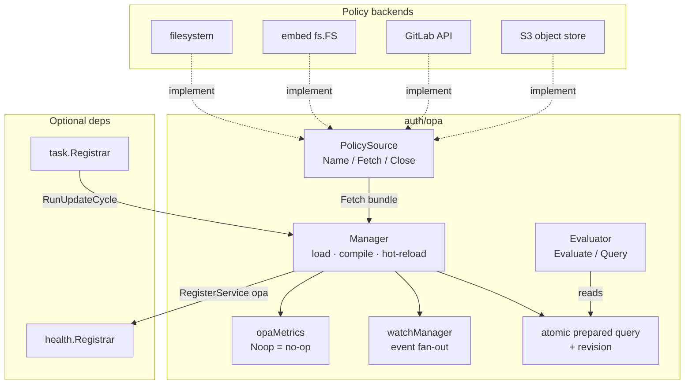
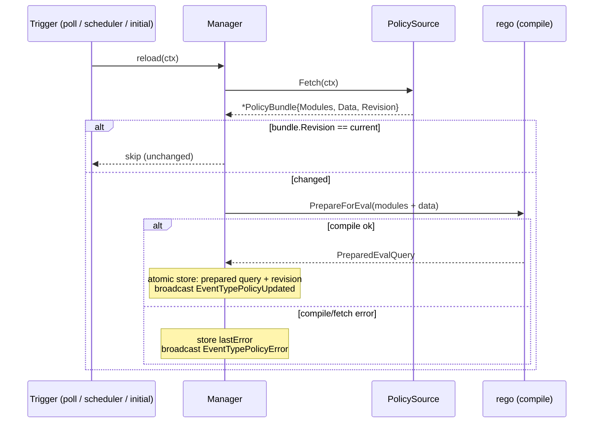

# Open Policy Agent (OPA)

Rego policy evaluation with pluggable policy sources, atomic hot-reload, event subscriptions, scheduled updates, health, and metrics.

---

## Table of Contents

- [Overview](#overview)
- [Architecture](#architecture)
  - [Component Relationships](#component-relationships)
  - [Reload Flow](#reload-flow)
- [Package Map](#package-map)
- [Quick Start](#quick-start)
- [Policy Sources](#policy-sources)
  - [Publishing releases](#publishing-releases)
  - [Source Matrix](#source-matrix)
  - [The PolicySource Interface](#the-policysource-interface)
  - [Outbound HTTP (GitLab, S3)](#outbound-http-gitlab-s3)
- [Evaluation](#evaluation)
  - [Boolean vs. Structured Queries](#boolean-vs-structured-queries)
  - [Result](#result)
- [Hot Reload and Change Detection](#hot-reload-and-change-detection)
- [Watching for Policy Events](#watching-for-policy-events)
- [Scheduled Updates](#scheduled-updates)
- [Factory](#factory)
- [Configuration](#configuration)
- [Health](#health)
- [Errors](#errors)
- [Metrics](#metrics)
- [Thread Safety](#thread-safety)

---

## Overview

The `auth/opa` package evaluates [Open Policy Agent](https://www.openpolicyagent.org/) Rego policies for authorization decisions. A
`Manager` loads a `PolicyBundle` from a `PolicySource`, compiles it against a fixed Rego query, and hands out a thread-safe `Evaluator`.
When the source changes, the manager recompiles and swaps the prepared query atomically, so in-flight evaluations always see a consistent
policy set.

The design is modular:

- **Sources are passive.** A `PolicySource` only fetches a bundle. All polling, change detection, and scheduling live in the `Manager`.
- **Reloads are atomic.** A new bundle is compiled into a fresh prepared query and stored behind an `atomic.Pointer`. Readers never block
  on a reload and never observe a half-applied policy set.
- **Updates are event-driven.** Subscribers receive `PolicyEvent`s on update and on error, with configurable buffering and overflow policy.

## Architecture

### Component Relationships



### Reload Flow



Change detection is revision-based: `PolicyBundle.Revision` is a full 64-hex-character SHA-256 digest over the length-prefixed sorted module
paths/contents (and JSON-marshaled data). A fetch whose revision equals the loaded one is a no-op, so a quiet source costs only the fetch.

## Package Map

| File                                    | Responsibility                                                                     |
|-----------------------------------------|------------------------------------------------------------------------------------|
| `manager.go`                            | `Manager`, initial load, atomic reload, poll loop, `regoEvaluator`, denial parsing |
| `evaluator.go`                          | `Evaluator`, `Result`                                                              |
| `source.go`                             | `PolicySource` interface                                                           |
| `bundle.go`                             | `PolicyBundle`, revision hashing, iterators                                        |
| `event.go`                              | `PolicyEvent`, `EventType`, `WatchOptions`, `WatchResult`, overflow policy         |
| `watcher.go`                            | `watchManager` — subscription fan-out                                              |
| `scheduler.go`                          | Scheduler task registration (`RunUpdateCycle`)                                     |
| `health.go`                             | Health check reporting                                                             |
| `metrics.go`                            | `opaMetrics` (reloads, evaluations, latency, modules)                              |
| `errors.go`                             | Sentinel errors                                                                    |
| `cache.go` / `snapshot.go`              | `DecisionCache` interface, cache key derivation, nondeterministic-builtin check    |
| `options.go` / `options_gen.go`         | Functional options                                                                 |
| `factory/auth/opa/`                     | Config-driven builder (`factory.New(cfg).…Build(ctx)`)                             |
| `sources/{embed,filesystem,gitlab,s3}/` | `PolicySource` implementations                                                     |

## Quick Start

```go
source, err := filesystem.New("/etc/policies", filesystem.WithReleaseManifest("release.json"))
if err != nil {
    return err
}

manager, err := opa.NewManager(ctx, source, "data.authz.allow")
if err != nil {
    return err
}
defer manager.Close()

result, err := manager.Evaluator().Evaluate(ctx, map[string]any{
    "user":   "alice",
    "action": "read",
})
if err != nil {
    return err
}
if result.Allow {
    // access granted
}
```

`NewManager` takes the source and the Rego query as positional arguments and performs the initial load before returning, so a nil source,
empty query, or a policy set that fails to compile surfaces immediately rather than on first evaluation.

## Policy Sources

### Source Matrix

| Source     | Import               | Backend                          | Notes                                                                       |
|------------|----------------------|----------------------------------|-----------------------------------------------------------------------------|
| Embed      | `sources/embed`      | `fs.FS` compiled into the binary | Immutable; revision is fixed at build time                                  |
| Filesystem | `sources/filesystem` | Local directory                  | No `fsnotify`; changes are detected by the `Manager` poll loop or scheduler |
| GitLab     | `sources/gitlab`     | Repository via GitLab API        | Network-backed; supports resilient HTTP client                              |
| S3         | `sources/s3`         | S3-compatible object store       | Network-backed; AWS SDK or Atlas HTTP client                               |

Each source is a passive fetcher. The `Manager` drives polling at `pollInterval` (default 30s) when watching, or runs cycles on the
scheduler when one is wired.

### The PolicySource Interface

```go
type PolicySource interface {
    Name() string                                  // identifier used in events and logs
    Fetch(ctx context.Context) (*PolicyBundle, error)
    Close() error
}
```

A `PolicyBundle` carries the Rego `Modules` (path → raw content), optional `Data` (JSON loaded into OPA's store), a `Revision` for change
detection, and a `FetchedAt` timestamp. Build one with `NewPolicyBundle(modules)` or `NewPolicyBundleWithData(modules, data)` (which returns
`(*PolicyBundle, error)` and fails if any data value cannot be JSON-marshaled); both compute the revision hash for you.

### Publishing releases

Filesystem and S3 sources require a complete release manifest. Each fetch reads one manifest and verifies every included Rego module and enabled
JSON data file. Partial and mismatched releases leave the previous snapshot active and cause the health check to report `NotServing` until a successful
fetch.

Use a manifest with a relative `root` such as `releases/2026-11-25` and a `files` object keyed by paths relative to that release root. Stage the
complete new release under a new root before changing the manifest. Each fetch reads the manifest once and stays within the selected root.

- **Filesystem.** Set `opa.bundlePath: /etc/policies` and `opa.releaseManifest: release.json`. Each `files` value is a lowercase SHA-256 hex digest.
  Write the manifest to a temporary file on the same filesystem and atomically rename it over `/etc/policies/release.json`.
- **S3.** Set `opa.s3.prefix: policies/opa` and `opa.s3.releaseManifest: release.json`. Each `files` value has `etag` (the full quoted S3 ETag) and
  `sha256` (a lowercase hex digest). Replace `policies/opa/release.json` with a single PUT. Every policy and data GET sends the recorded ETag as
  `If-Match` and verifies the digest.

Publish the first complete release before service startup. Keep the old root intact until fetches that could have read its manifest have finished,
then delete it. Fixed layouts may use a flat manifest at the configured base. See the [filesystem source](../../auth/opa/sources/filesystem/) and
[S3 source](../../auth/opa/sources/s3/) for exact formats and examples.

### Outbound HTTP (GitLab, S3)

The GitLab and S3 sources reach external services and accept proxy / retry / breaker configuration through the resilient
[`net/http/client`](https://github.com/altessa-s/go-atlas-net/tree/develop/http/client):

- **GitLab** receives a client via `gitlab.WithHTTPClient(...)`; the factory always injects the resilient client.
- **S3** receives the resilient client when `s3.proxy.mode: none` or `s3.ssrf` is set. With both settings omitted, the AWS SDK handles HTTP
  transport and retries.

See the [Proxy guide](../proxy.md) for YAML modes and the [factory README](../../factory/auth/opa/) for wiring details.

Integrity of remote policies:

- **GitLab** requires an `https://` endpoint (`ErrInsecureEndpoint`; opt out with `gitlab.WithAllowInsecureHTTP`, in YAML `gitlab.allowInsecureHTTP:
  true`) and caps each file at `gitlab.WithMaxFileBytes` (default 32 MiB). Each `Fetch` resolves `ref` to a single commit SHA (SHA-1 or SHA-256) and reads
  both the tree and every file at that pinned commit.
- **S3** built by the factory requires an `https://` `s3.endpoint` when one is set (`s3source.ErrInsecureEndpoint`; opt out with
  `s3.allowInsecureHTTP: true`). An injected client's endpoint is the caller's to secure. Non-empty prefixes are normalized to end with `"/"` so listing
  matches an exact directory prefix (for example, `"policies"` matches `"policies/..."` and not `"policies-v2/..."`).
- **GitLab** accepts optional `gitlab.checksums` to verify the SHA-256 digests of every included module and JSON document in the pinned commit.

## Evaluation

`Manager.Evaluator()` returns a thread-safe `Evaluator` that reads the current prepared query on every call:

```go
type Evaluator interface {
    Evaluate(ctx context.Context, input any) (*Result, error)
    Query() string
}
```

`Evaluate` returns `ErrPoliciesNotLoaded` if no bundle has been compiled yet, denies (no error) when the query yields nothing, and wraps
any Rego evaluation failure with operation context.

### Boolean vs. Structured Queries

The evaluator accepts two result shapes from the same `Evaluate` call, chosen by what the query returns:

- **Boolean** — a query like `data.authz.allow` returns a plain `bool`. `Result.Allow` is set; `Denials` is nil.
- **Structured** — a query like `data.authz.result` returns `{"allow": bool, "denials": [{"code": "...", "message": "..."}, ...]}`. The
  `allow` flag and the denials map are parsed out.

Any other (unrecognized) result type denies. This keeps simple allow/deny policies trivial while letting richer policies report *why* a
request was denied.

### Result

```go
type Result struct {
    DecisionID string   // set only when decision logging is enabled
    Allow      bool
    Denials    *coremaps.ImmutableMap[string, string] // code → message, nil when Allow
}

func (r *Result) HasDenialCode(code string) bool
```

Every evaluation returns a freshly allocated `Result` (no shared singletons), so a caller may enrich it without affecting concurrent
evaluations. Enabling `WithDecisionLogging` additionally stamps a unique per-evaluation `DecisionID` (UUID) for audit correlation.

## Hot Reload and Change Detection

`StartWatching(ctx)` spawns a poll loop that fetches the source every `pollInterval` and reloads when the revision changes; `StartWatchingUntilClose()`
runs the same loop on the manager's lifetime context until `Close()` (used by `factory/auth/opa` when `watchBundle: true`). `StopWatching()` ends it,
and `IsWatching()` reports the state. A reload:

1. Fetches the bundle. On failure it records `lastError`, broadcasts an error event, and returns `ErrBundleFetchFailed`.
2. Compares revisions. An unchanged revision is a logged no-op.
3. Compiles the modules (and loads any data into a fresh in-memory store). A compile failure broadcasts an error event and returns
   `ErrQueryPrepareFailed`.
4. Atomically swaps the prepared query and revision, updates module count and `lastUpdate`, clears `lastError`, and broadcasts
   `EventTypePolicyUpdated`.

Concurrent update cycles are guarded: if a cycle is already running, the next one returns immediately rather than piling up.

## Watching for Policy Events

Subscribe to reload and error events with `Watch`:

```go
watch, err := manager.Watch(ctx, opa.DefaultWatchOptions())
if err != nil {
    return err
}
defer watch.Stop()

for event := range watch.Events {
    switch event.Type {
    case opa.EventTypePolicyUpdated:
        log.Printf("policies updated: %s (was %s)", event.Revision, event.PreviousRevision)
    case opa.EventTypePolicyError:
        log.Printf("policy error: %v", event.Error)
    }
}
```

`WatchOptions` tunes the subscription: `BufferSize` (default 10), an `EventTypes` filter (empty = all), and a `BufferOverflowPolicy` for a
full buffer:

| Policy                     | Behavior                                                                                |
|----------------------------|-----------------------------------------------------------------------------------------|
| `OverflowPolicyDropNewest` | Drop the incoming event (default). Non-blocking; never delays the producer              |
| `OverflowPolicyDropOldest` | Evict the oldest event to admit the newest. Keeps the most recent events                |
| `OverflowPolicyBlock`      | Block until space frees or the context cancels. Can slow the producer, so use with care |

`WatchResult` exposes the `Events` channel, a `Stop` function, and a `Done` channel closed when the watch ends.

## Scheduled Updates

Instead of (or alongside) the internal poll loop, drive reloads from a cron scheduler. Provide a `schedtask.Registrar` via
`WithScheduler` and a cron expression via `WithUpdateSchedule`:

```go
manager, err := opa.NewManager(ctx, source, "data.authz.allow",
    opa.WithScheduler(reg),
    opa.WithUpdateSchedule("0 */5 * * * *", true), // every 5 minutes, run once on start
)
```

`WithUpdateSchedule` takes the cron expression and a `runOnStart` flag. A nonempty schedule without a registrar returns `opa.ErrSchedulerRequired`.
Static configurations need no registrar. The factory requires `UseScheduler` when `updateSchedule` is set and `watchBundle` is false. When
`WithSchedulerTaskID` is omitted, the task ID defaults deterministically to `opa-policy-update-<24-hex-chars>` derived from `source.Name()` and `query`. The registered task
runs the same guarded update cycle as the poll loop. Calling the scheduler-managed entry point directly returns `cycle.ErrManaged` from
`go-atlas-core/runtime/cycle`.

## Factory

For configuration-driven setup, the [`factory`](../../factory/auth/opa/) package builds a manager from an OPA config block with a fluent,
deferred-error builder: every step accumulates errors and `Build(ctx)` returns the first one:

```go
manager, err := factory.New(cfg.OPA).
    UseLogger(logger).
    UseMeter(meter).
    UseScheduler(scheduler).
    UseHealthCoordinator(hc).
    Build(ctx)
```

`Build` applies the selected source's `proxy` and `ssrf` blocks. Atlas clients have SSRF protection enabled by default and connect directly while
protection is on. Mode `none` always connects directly, and the factory rejects explicit `url` and `host` modes.

Configure `opa.gitlab.ssrf` or `opa.s3.ssrf` for private endpoints. The `allowedCIDRs` list and `allow` rules exempt trusted networks, a matching
`deny` rule takes precedence, and `disabled: true` turns protection off. An empty `s3.ssrf` block selects the Atlas client with protection enabled.
See the [SSRF configuration template](../../config/templates/http_client_ssrf.yaml) for all fields.

```yaml
opa:
  gitlab:
    ssrf:
      allowedCIDRs:
        - 10.0.2.0/24
  s3:
    ssrf:
      allow:
        - cidr: 10.0.3.0/24
          host: s3.internal.example
          port: 443
```

## Configuration

Options are functional, applied to `NewManager`:

| Option                         | Default                     | Description                                                                   |
|--------------------------------|-----------------------------|-------------------------------------------------------------------------------|
| `WithLogger`                   | discard                     | Structured `*slog.Logger`                                                     |
| `WithDecisionLogging`          | `false`                     | Stamp a unique `DecisionID` on every result for audit correlation             |
| `WithWatchChannelSize`         | 10                          | Default buffer size for watch event channels                                  |
| `WithScheduler`                | nil                         | `TaskRegistrar` for scheduler-driven update cycles                            |
| `WithSchedulerTaskID`          | deterministic hash          | Override task ID (default: `opa-policy-update-<24-hex-chars>`)                |
| `WithUpdateSchedule`           | —                           | Cron expression + run-on-start flag (requires `WithScheduler`)                |
| `WithHealthCoordinator`        | nil                         | Register the manager with a `health.Registrar` (e.g. `*health.Coordinator`)   |
| `WithPollInterval`             | 30s (`DefaultPollInterval`) | Interval between source polls when watching                                   |
| `WithMeter`                    | `metrics.Noop()`            | Metrics collector                                                             |
| `WithAuditRecorder`            | nil                         | `DecisionRecorder` recording every evaluation decision; nil disables auditing |
| `WithDecisionCache(size, ttl)` | off                         | Memoize decisions per (revision, input); bounded by `size` entries and `ttl`  |
| `WithDecisionCacheBackend(c)`  | nil                         | Supply a custom `DecisionCache` (`Get` / `Put`) backend                       |

The poll interval defaults to `DefaultPollInterval` (30s). `WithDecisionLogging` is the one option with a runtime cost worth weighing: it
adds a UUID generation per evaluation for traceable decision IDs.

For custom decision caching, `WithDecisionCacheBackend` accepts a `DecisionCache` (`Get(key string) (Result, bool)`, `Put(key string, result Result)`).
Queries that reach nondeterministic Rego builtins (such as `time.now_ns()`) are not cached even when a decision cache is enabled.

## Health

When a `health.Registrar` (such as `*health.Coordinator`) is supplied, `NewManager` registers the manager as the `"opa"` service. The health check
reflects the manager's loaded state and last reload outcome, so a source that starts failing surfaces through the standard `/healthz` / `/readyz` probes
rather than silently serving stale policy.

## Errors

| Sentinel                | Returned when                                                |
|-------------------------|--------------------------------------------------------------|
| `ErrSourceRequired`     | `NewManager` got a nil source                                |
| `ErrQueryRequired`      | `NewManager` got an empty query                              |
| `ErrPoliciesNotLoaded`  | `Evaluate` called before any bundle compiled                 |
| `ErrSourceClosed`       | Operation on a closed source                                 |
| `ErrManagerClosed`      | Operation on a closed manager                                |
| `ErrNoPolicyFiles`      | No policy files found at the configured path                 |
| `ErrBundleFetchFailed`  | Fetching the bundle from the source failed                   |
| `ErrQueryPrepareFailed` | Compiling the Rego query against the loaded modules failed   |
| `ErrWatchStartFailed`   | Starting the watch on the source failed                      |
| `ErrInvalidDataPath`    | A bundle data key could not be parsed into an OPA store path |

A scheduler-managed entry point called directly returns `cycle.ErrManaged` from `go-atlas-core/runtime/cycle`.

`ErrBundleFetchFailed` and `ErrQueryPrepareFailed` are joined with the underlying cause, so `errors.Is` matches the sentinel while the
original error stays reachable through the chain.

## Metrics

Metrics are published under the `auth_opa` subsystem. With no collector, `metrics.Noop()` is used and every write is a zero-cost no-op.

| Metric                                    | Type      | Labels   | Description                                                              |
|-------------------------------------------|-----------|----------|--------------------------------------------------------------------------|
| `auth_opa_policy_reloads_total`           | Counter   | `result` | Reload outcomes (`success`, `unchanged`, `fetch_error`, `prepare_error`) |
| `auth_opa_policy_reload_duration_seconds` | Histogram | —        | Reload duration                                                          |
| `auth_opa_evaluations_total`              | Counter   | `result` | Evaluation outcomes (`allow`, `deny`, `error`)                           |
| `auth_opa_evaluation_duration_seconds`    | Histogram | —        | Evaluation duration                                                      |
| `auth_opa_modules_loaded`                 | Gauge     | —        | Modules in the currently loaded bundle                                   |
| `auth_opa_decision_cache_lookups_total`   | Counter   | `result` | Decision cache lookups (`hit`, `miss`); only when a decision cache is enabled |

## Thread Safety

All public methods on `Manager` and `Evaluator` are safe for concurrent use. Reloads publish the prepared query and revision through atomic
pointers, so evaluations never block on a reload and never observe a partially applied bundle. Update cycles are de-duplicated, and `Close`
is idempotent.

---

See the package [`README`](../../auth/opa/README.md) and the [`factory`](../../factory/auth/opa/) / source subpackage READMEs for
file-level reference, and [`docs/auth/oidc.md`](oidc.md), [`docs/auth/selfjwt.md`](selfjwt.md), and [`docs/auth/static.md`](static.md) for
the other authentication and authorization building blocks.
