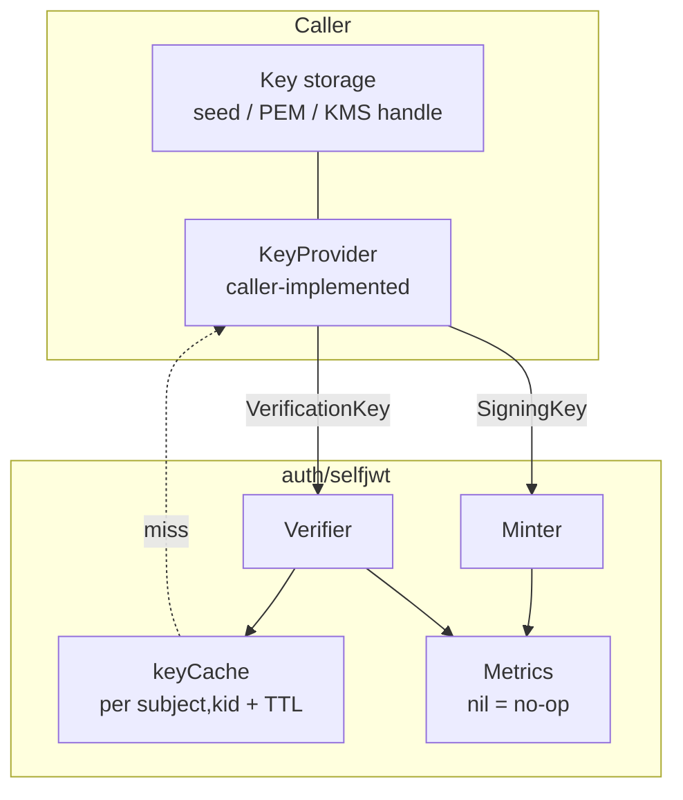
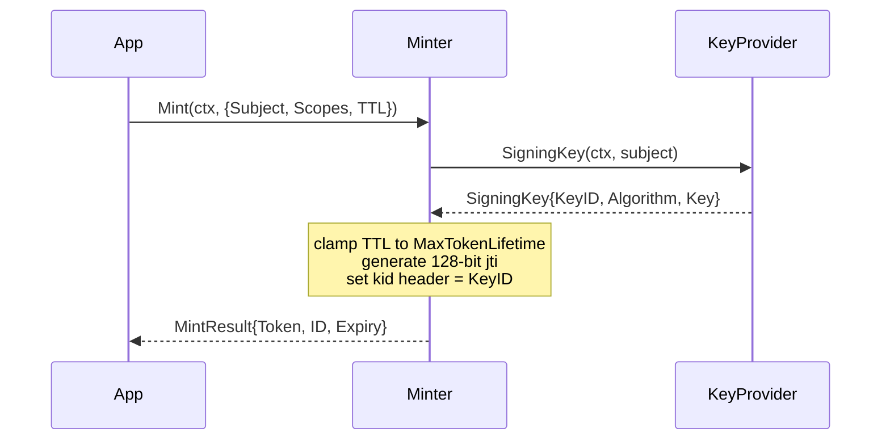
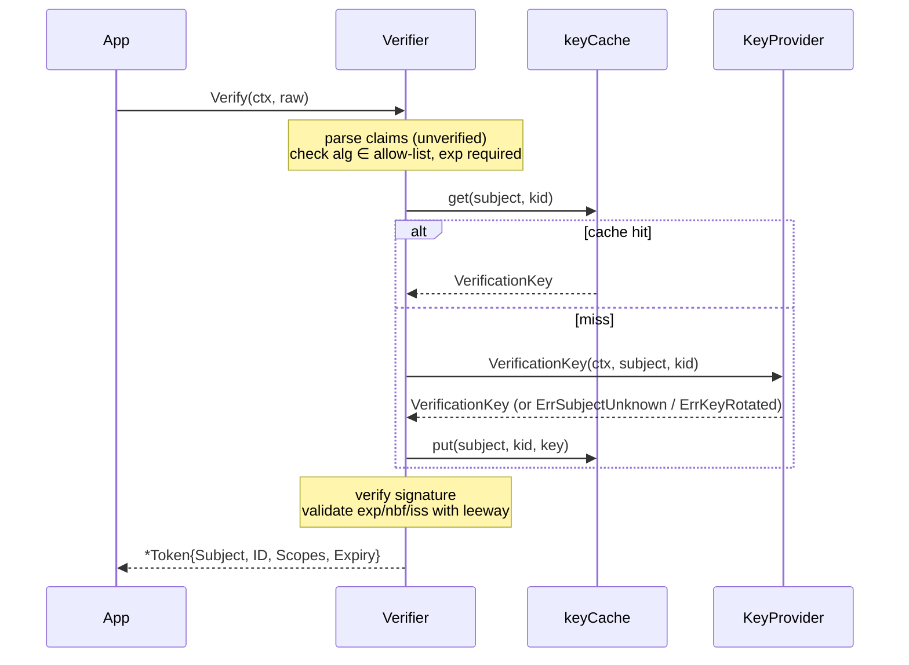

# Self-Issued JWT (selfjwt)

Minting and verification of self-issued, per-subject JWTs for services that are both the issuer and the verifier of their own tokens.

---

## Table of Contents

- [Overview](#overview)
- [When to Use selfjwt vs. oidc](#when-to-use-selfjwt-vs-oidc)
- [Architecture](#architecture)
  - [Component Relationships](#component-relationships)
  - [Mint Flow](#mint-flow)
  - [Verify Flow](#verify-flow)
- [Package Map](#package-map)
- [Quick Start](#quick-start)
- [The KeyProvider Seam](#the-keyprovider-seam)
- [Key Rotation](#key-rotation)
- [Configuration](#configuration)
- [Go API](#go-api)
  - [Minter](#minter)
  - [Verifier](#verifier)
  - [Token](#token)
- [Algorithms](#algorithms)
- [Security Model](#security-model)
- [Verification-Key Cache](#verification-key-cache)
- [Errors](#errors)
- [Metrics](#metrics)
- [Real-World Examples](#real-world-examples)

---

## Overview

The `auth/selfjwt` package mints and verifies JWTs for a service that owns **both ends** of the token lifecycle. A service signs a token
for a subject (a tenant, an account, any principal) with that subject's private key, stamps the signing key's id into the token's `kid`
header, and later verifies the token by resolving the subject's public key for that `kid`.

This closes a loop a generic JWT library leaves open:

1. **Mint** — load the subject's signing key, sign a JWT carrying the subject, a random `jti`, the granted scopes, and the temporal claims.
2. **Verify** — parse the token (allowed algorithms only, `exp` required), resolve the subject's public key by `kid`, check the signature,
   then validate the temporal and issuer claims.
3. **Rotate** — issuing a subject a new `kid` retires the old key; every token still carrying the old `kid` stops verifying.

The package is transport-neutral and algorithm-agnostic. It hard-codes neither a key store nor a signature algorithm: a caller-supplied
[`KeyProvider`](#the-keyprovider-seam) is the only seam to key storage, and the accepted algorithms are an allow-list.

## When to Use selfjwt vs. oidc

|                 | [`auth/oidc`](oidc.md)                             | `auth/selfjwt`                                                                                 |
|-----------------|----------------------------------------------------|------------------------------------------------------------------------------------------------|
| Token issuer    | An external identity provider (Keycloak, Auth0, …) | This service                                                                                   |
| Token verifier  | This service                                       | This service                                                                                   |
| Key discovery   | Remote JWKS over the well-known endpoint           | A local `KeyProvider` resolving keys per subject                                               |
| Key granularity | One key set for the issuer                         | One signing key **per subject**, rotated per subject                                           |
| Revocation      | Revocation store / introspection                   | Key rotation (new `kid` invalidates old tokens); optional per-`jti` check via `WithRevocation` |

Use `oidc` to validate tokens minted elsewhere. Use `selfjwt` when the service issues its own short-lived, per-subject credentials
(service-to-tenant API tokens, download URLs, capability tokens) and wants per-subject key rotation as the invalidation primitive.

## Architecture

### Component Relationships



`Minter` and `Verifier` are independent: `Minter` depends only on `SigningKeyProvider` (`MinterOption`), `Verifier` depends only on
`VerificationKeyProvider` (`VerifierOption`), and `New` pairs both over `KeyProvider` (`PairOption`).

### Mint Flow



### Verify Flow



Concurrent misses for the same `(subject, kid)` are collapsed into a single `KeyProvider` lookup via `singleflight`, so a burst of
requests for an uncached subject cannot stampede the provider.

## Package Map

| File                            | Responsibility                                                   |
|---------------------------------|------------------------------------------------------------------|
| `minter.go`                     | `Minter`, `MintRequest`, `MintResult`, `jti` generation          |
| `verifier.go`                   | `Verifier`, parse → resolve key → verify, singleflight on misses |
| `keys.go`                            | `SigningKeyProvider`, `VerificationKeyProvider`, `KeyProvider`   |
| `token.go`                      | `Token` (verified result) and the internal claim set             |
| `algorithm.go`                  | The default allow-list (uses `auth/jwt` algorithms)     |
| `cache.go`                      | `keyCache` — per-`(subject, kid)` TTL cache with a size cap      |
| `clock.go`                      | `Clock` seam (system UTC in production, injectable in tests)     |
| `metrics.go`                    | `Metrics` (mint/verify counters, latency, cache hit/miss)        |
| `errors.go`                     | Sentinel errors                                                  |
| `options.go` / `*_options_gen.go`    | Functional options (`minter_options_gen.go`, `verifier_options_gen.go`, `pair_options_gen.go`) |

## Quick Start

```go
provider := myKeyStore{} // implements selfjwt.KeyProvider

// Issuer side.
minter := selfjwt.NewMinter(provider, "billing", "billing-api")
res, err := minter.Mint(ctx, selfjwt.MintRequest{
    Subject: tenantID,
    Scopes:  []string{"files:read"},
    TTL:     time.Hour,
})
// res.Token is the serialized JWT; persist res.ID (jti) and res.Expiry as the caller sees fit.

// Verifier side.
verifier := selfjwt.NewVerifier(provider, "billing", "billing-api")
tok, err := verifier.Verify(ctx, res.Token)
switch {
case errors.Is(err, selfjwt.ErrTokenExpired):
    // expired
case errors.Is(err, selfjwt.ErrSubjectUnknown), errors.Is(err, selfjwt.ErrKeyRotated):
    // unknown subject or rotated-away key
case err != nil:
    // ErrTokenInvalid / ErrAlgorithmNotAllowed
default:
    use(tok.Subject, tok.Scopes, tok.Expiry)
}
```

## The KeyProvider Seam

`SigningKeyProvider`, `VerificationKeyProvider`, and their composite `KeyProvider` form the seam between `selfjwt` and a caller's key storage. The
package never sees the underlying key format (a seed, a PEM blob, a KMS handle); providers return ready `crypto` keys.

```go
// SigningKeyProvider supplies signing keys for minting tokens.
type SigningKeyProvider interface {
    // SigningKey returns the subject's current signing material.
    // Return ErrSubjectUnknown when the subject has no keys.
    SigningKey(ctx context.Context, subject string) (jwt.SigningKey, error)
}

// VerificationKeyProvider resolves verification keys for verifying tokens.
type VerificationKeyProvider interface {
    // VerificationKey resolves a token's kid to the subject's public key,
    // accepting the current key and any retired-but-valid key still inside
    // the rotation overlap window.
    // Return ErrSubjectUnknown when the subject is unknown,
    // ErrKeyRotated when the subject is known but the kid is not.
    VerificationKey(ctx context.Context, subject, kid string) (jwt.VerificationKey, error)
}

// KeyProvider combines signing and verification key resolution.
type KeyProvider interface {
    SigningKeyProvider
    VerificationKeyProvider
}
```

`jwt.SigningKey` and `jwt.VerificationKey` each carry the `jwt.Algorithm` they are used with, plus the raw `crypto.PrivateKey` / `crypto.PublicKey`
whose concrete type must match (`ed25519.PrivateKey` for `EdDSA`, `*ecdsa.PrivateKey` for `ES*`, `*rsa.PrivateKey` for `RS*`/`PS*`).

Returning the right sentinel from the provider matters: `Verifier` propagates `ErrSubjectUnknown` and `ErrKeyRotated` **unwrapped** so a
caller can branch on them with `errors.Is`.

## Key Rotation

Rotation is the invalidation mechanism. Because the signing key's id rides in the token's `kid` header and the verifier resolves the public
key by that `kid`, a caller invalidates a subject's outstanding tokens by issuing the subject a new signing key (a new `kid`):

1. Generate a new key pair for the subject and make it the value returned by `KeyProvider.SigningKey`; new tokens carry the new `kid`.
2. Keep the **old** public key resolvable from `KeyProvider.VerificationKey` for an overlap window so already-minted tokens keep verifying until they
   expire naturally.
3. Once the overlap window passes the longest possible token lifetime, drop the old key. `KeyProvider.VerificationKey` then returns `ErrKeyRotated`
   for the old `kid` — but only on a cache miss.
4. Each `Verifier` caches resolved keys for `WithCacheTTL` (default 5 minutes), so a retired `kid` keeps verifying from cache until its entry
   expires. Call `InvalidateKey(subject, kid)` (or `InvalidateSubject(subject)` when the old `kid` is unknown) on **every** verifier
   instance — propagate the rotation event across processes yourself — to drop it early; `WithCacheTTL(0)` stops retaining entries at all.
   Invalidation also fences provider lookups already in flight: a lookup that read the old key before retirement cannot re-cache it, and
   verifications that start after the call never share that lookup — they consult the provider afresh (this holds with a zero TTL too).
   Only verifications that began before the call may still complete with the old key. Retire the key in the provider **before**
   invalidating, so the fresh lookups see it gone.

Issuing a new key stops new tokens under the old `kid`; retiring the old key rejects existing ones after the cache window or explicit
invalidation. A short overlap window plus a short `MaxTokenLifetime` keeps that window small without a revocation list.

## Configuration

The issuer and audience are required positional arguments of `NewMinter`, `NewVerifier` and `New`: the minter writes them as `iss` / `aud`, the
verifier rejects any other value, and an empty one fails `Mint` / `Verify` with `ErrIssuerRequired` / `ErrAudienceRequired`. Pass the same pair on
both sides; services that share a key provider but use different pairs cannot replay each other's tokens.

Use `MinterOption` with `NewMinter` and `VerifierOption` with `NewVerifier`. For `New`, each setting has a `WithPair…` setter, such as
`WithPairClock` or `WithPairCacheTTL`. A single pair clock applies to both roles.

| Option                                                          | Default                            | Applies to    | Description                                                                                                          |
| --------------------------------------------------------------- | ---------------------------------- | ------------- | -------------------------------------------------------------------------------------------------------------------- |
| `WithMaxTokenLifetime`                                          | 30 days                            | mint          | Ceiling a requested TTL is clamped to; a non-positive TTL uses the maximum                                           |
| `WithLeeway`                                                    | 30s (`DefaultLeeway`)              | verify        | Leeway applied to `exp` / `nbf` to tolerate clock drift between minter and verifier; clamped to `jwt.MaxLeeway` (5m) |
| `WithCacheTTL`                                                  | 5m                                 | verify        | How long a resolved verification key is cached before reload                                                         |
| `WithCacheMaxEntries`                                           | 10000                              | verify        | Cap on cached verification keys (LRU); a tenth of it caps cached provider misses separately; non-positive selects the default (10000) |
| `WithKeyLookupTimeout`                                          | 10s                                | verify        | Deadline for a shared key-provider lookup on a cache miss                                                            |
| `WithNegativeCacheTTL`                                          | 30s (`DefaultNegativeCacheTTL`)    | verify        | How long a provider `ErrSubjectUnknown` / `ErrKeyRotated` is cached; `0` disables it                                 |
| `WithMaxConcurrentLookups`                                      | 64 (`DefaultMaxConcurrentLookups`) | verify        | Distinct key-provider lookups in flight; a new one beyond it fails fast with `singleflight.ErrOverloaded`            |
| `WithMinterAllowedAlgorithms` / `WithVerifierAllowedAlgorithms` | `EdDSA, ES256, RS256`              | mint + verify | Replaces the asymmetric-only allow-list; an empty call is ignored                                                    |
| `WithMinterMetrics` / `WithVerifierMetrics`                     | nil (no-op)                        | mint + verify | Attaches a `*Metrics` for counters and latency                                                                       |
| `WithRevocation`                                                | nil (unchecked)                    | verify        | `jwt.RevocationChecker` rejecting a verified token whose `jti` is revoked (`jwt.ErrTokenRevoked`); a checker that cannot answer (an unprimed or stale `denylist/mirror`) rejects with `jwt.ErrRevocationUnavailable` |
| `WithMinterClock` / `WithVerifierClock`                         | system UTC                         | mint + verify | Injectable clock for deterministic tests                                                                             |
| `WithRand`                                                      | `crypto/rand`                      | mint          | Injectable randomness for the `jti`                                                                                  |

## Go API

### Minter

```go
func NewMinter(src SigningKeyProvider, issuer, audience string, opts ...MinterOption) *Minter
func (m *Minter) Mint(ctx context.Context, req MintRequest) (MintResult, error)

type MintRequest struct {
    Subject string
    Scopes  []string
    TTL     time.Duration // clamped to MaxTokenLifetime; <= 0 means use the maximum
}

type MintResult struct {
    Token  string    // serialized JWT
    ID     string    // jti — persist for audit / dedupe
    Expiry time.Time // absolute exp
}
```

`Mint` returns `ErrSubjectRequired` for an empty `Subject`, `ErrIssuerRequired` / `ErrAudienceRequired` for an empty issuer / audience,
`ErrSigningKeyInvalid` when the provider hands back signing material with an empty `KeyID`, and `ErrAlgorithmNotAllowed` when the signing key names an
algorithm outside the `WithMinterAllowedAlgorithms` allow-list or not registered with golang-jwt.

### Verifier

```go
func NewVerifier(src VerificationKeyProvider, issuer, audience string, opts ...VerifierOption) *Verifier
func (v *Verifier) Verify(ctx context.Context, raw string) (*Token, error)
```

The parser options (valid methods, expiration-required, leeway, issuer, audience) are built once in `NewVerifier`, so `Verify` allocates no option
slice per call.

### Token

```go
type Token struct {
    Subject string    // verified sub claim
    ID      string    // jti
    Scopes  []string  // granted scopes
    Expiry  time.Time // exp
}
```

`Token` is intentionally minimal: registered claims plus scopes. Any richer principal model (roles, superadmin flags, quotas) is the
caller's concern and is built on top of this.

## Algorithms

`jwt.Algorithm` is a plain JWA name string. The constants cover the asymmetric algorithms golang-jwt supports out of the box:

| Family          | Constants                          |
|-----------------|------------------------------------|
| EdDSA           | `jwt.AlgEdDSA`                         |
| ECDSA           | `jwt.AlgES256`, `jwt.AlgES384`, `jwt.AlgES512` |
| RSA PKCS#1 v1.5 | `jwt.AlgRS256`, `jwt.AlgRS384`, `jwt.AlgRS512` |
| RSA PSS         | `jwt.AlgPS256`, `jwt.AlgPS384`, `jwt.AlgPS512` |

`jwt.DefaultAllowedAlgorithms()` returns a copy of the verifier's fail-closed default allow-list: `EdDSA`, `ES256`, `RS256`. To support an
algorithm not registered out of the box, register a signing method with golang-jwt via `jwt.RegisterSigningMethod`, then pass it through
`WithVerifierAllowedAlgorithms`.

## Security Model

Verification is fail-closed:

- **Algorithm before signature.** The token algorithm is checked against the allow-list **before** the signature is verified, closing
  algorithm-confusion attacks. The default allow-list is asymmetric only; HMAC (`HS256`, …) is intentionally excluded so a symmetric
  secret can never be confused with a public key.
- **Each key is bound to one algorithm.** A `jwt.VerificationKey` must set its `Algorithm` field to the algorithm it verifies; the verifier rejects a token whose
  algorithm is empty or does not match the resolved key's algorithm, so a key can never be coerced into verifying a different scheme.
- **`exp` is mandatory.** Tokens without an expiry are rejected, `"exp": 0` is treated as expired, and temporal claims (`exp` / `nbf` / `iat`) are
  decoded as exact `json.Number` values (via `auth/jwt`) and validated with the configured clock-skew leeway.
- **Singleflight on cache misses.** Concurrent misses for the same `(subject, kid)` collapse into one provider lookup, so an uncached
  subject cannot stampede the key store.

## Verification-Key Cache

`Verifier` caches resolved verification keys per `(subject, kid)` with a TTL (`WithCacheTTL`) so it avoids a provider lookup on every
request. The cache is safe for concurrent use. An expired entry reads as a miss. Verified keys and key-provider misses live in two separate LRU caches (`cache/lru`):
the miss cache is a tenth of the `WithCacheMaxEntries` cap, so unauthenticated tokens with random subjects can only evict other misses, never a
verified key, and a full cache evicts the least recently used entry in constant time. A non-positive cap selects the default (10000): the cache is
always bounded.

Revocation: `WithRevocation` needs every token to carry a string `jti` (the minter always sets one); a token without it is rejected, because it
could never be revoked. A checker that cannot answer, such as a `denylist/mirror` that is unprimed or stale, rejects the token with
`jwt.ErrRevocationUnavailable`, distinct from `jwt.ErrTokenRevoked`. Prime the mirror before serving (see [denylist.md](denylist.md)).

`InvalidateKey` and `InvalidateSubject` advance a cache-wide invalidation generation. A lookup records the generation before consulting the provider,
uses it in its `singleflight` key, and caches its result only if no invalidation happened meanwhile — so an invalidation fences lookups already in
flight. The generation is cache-wide rather than per subject to keep the bookkeeping bounded; an invalidation therefore also makes an overlapping
lookup
for an unrelated subject skip one cache populate.

## Errors

| Sentinel                 | Meaning                                                                                  |
|--------------------------|------------------------------------------------------------------------------------------|
| `ErrTokenInvalid`        | Malformed token, unexpected algorithm, bad signature, or a non-expiry claim failure      |
| `ErrTokenExpired`        | `exp` is in the past beyond the clock-skew leeway                                        |
| `ErrSubjectUnknown`      | `KeyProvider` has no keys for the subject (propagated unwrapped)                         |
| `ErrKeyRotated`          | Subject is known but the `kid` is not — rotated away (propagated unwrapped)              |
| `ErrAlgorithmNotAllowed` | Algorithm is unregistered, mismatched, or the resolved key names no algorithm            |
| `ErrSigningKeyInvalid`   | `Minter` got signing material that cannot produce a verifiable token (e.g. empty key id) |
| `ErrSubjectRequired`     | `Minter` got a `MintRequest` with an empty `Subject`                                     |
| `ErrIssuerRequired`      | The minter or verifier was built with an empty issuer                                    |
| `ErrAudienceRequired`    | The minter or verifier was built with an empty audience                                  |

Always compare with `errors.Is`. `ErrTokenExpired` and `ErrTokenInvalid` wrap the underlying golang-jwt error, so the original cause is
available through the chain.

## Metrics

Pass a `*Metrics` via `WithPairMetrics`, `WithMinterMetrics` or `WithVerifierMetrics` to record telemetry. Metrics are optional.
Construct one with `NewMetrics(collector, subsystem)`; an empty subsystem falls back to `DefaultMetricsSubsystem` (`auth_selfjwt`).

| Metric                                              | Type      | Labels   | Description                                     |
|-----------------------------------------------------|-----------|----------|-------------------------------------------------|
| `auth_selfjwt_mints_total`                          | Counter   | `status` | Token mint attempts                             |
| `auth_selfjwt_verifications_total`                  | Counter   | `status` | Token verification attempts                     |
| `auth_selfjwt_mint_duration_seconds`                | Histogram | `status` | Mint duration                                   |
| `auth_selfjwt_verify_duration_seconds`              | Histogram | `status` | Verification duration                           |
| `auth_selfjwt_verification_key_cache_lookups_total` | Counter   | `result` | Verification-key cache lookups (`hit` / `miss`) |

`status` is `success` or `failure`.

## Real-World Examples

### Per-tenant API tokens

A billing service issues each tenant a short-lived token scoped to the operations the tenant may perform, signed with the tenant's own
key. Compromise of one tenant's key (or a routine rotation) invalidates only that tenant's outstanding tokens, with no shared secret and
no central revocation list.

```go
minter := selfjwt.NewMinter(tenantKeys, "billing", "billing-api", selfjwt.WithMaxTokenLifetime(15*time.Minute))
res, _ := minter.Mint(ctx, selfjwt.MintRequest{Subject: tenantID, Scopes: []string{"invoices:read"}, TTL: 15 * time.Minute})
```

### Capability / download URLs

Mint a token granting one capability (read one object) with a tight TTL, embed it in a signed URL, and verify it on the download path.
Rotating the subject's key revokes every outstanding URL for that subject once the old key is retired and dropped from each verifier's cache
(`InvalidateSubject`, or after `WithCacheTTL`).

### Internal service mesh, no external IdP

Where running an OIDC provider is overkill, each service verifies peer tokens against keys it already holds via its `KeyProvider`, keeping
the auth surface inside the mesh. Pair with mTLS at the transport layer for channel security; `selfjwt` carries the subject and scopes.

---

See the package [`README`](../../auth/selfjwt/README.md) for the file-level reference, and [`docs/auth/oidc.md`](oidc.md) for validating
externally-issued tokens.
